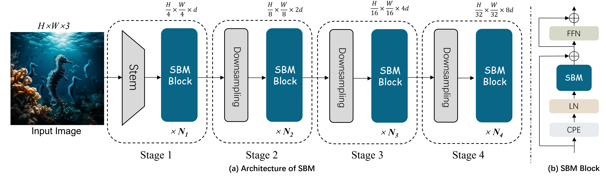
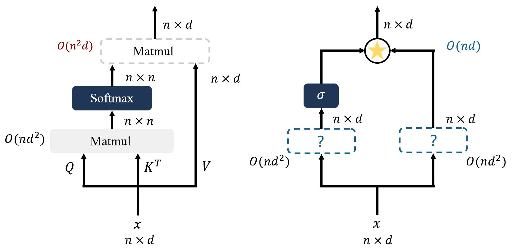
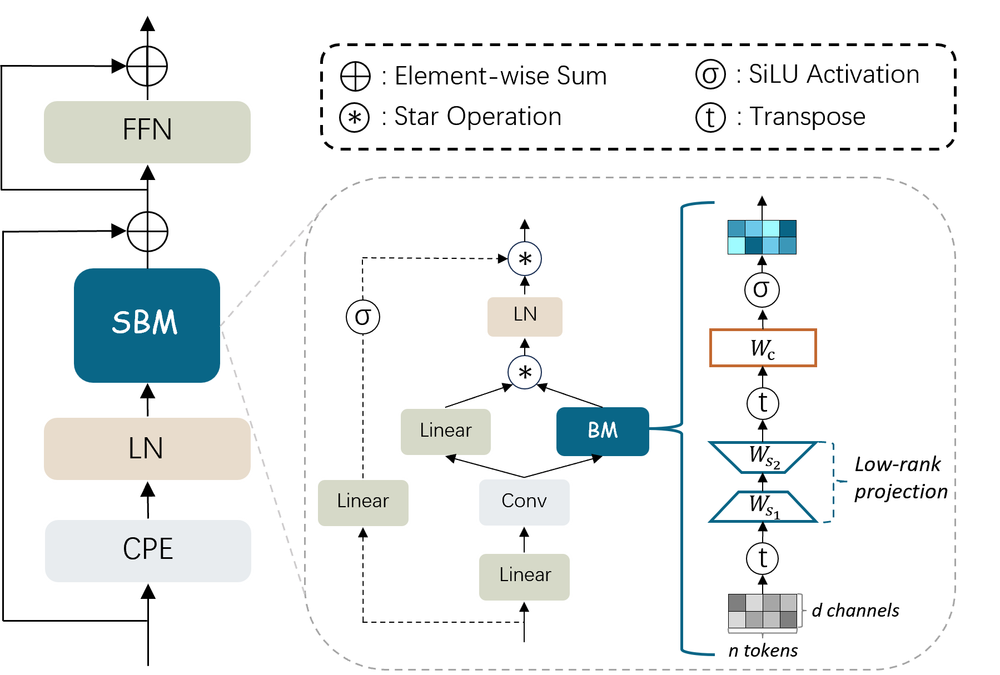
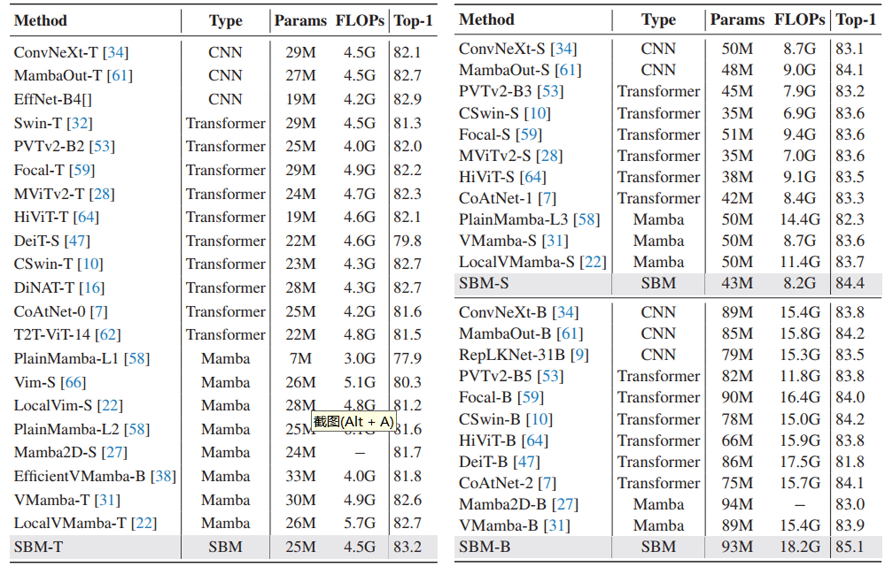

# 🌟 Star with Bilinear Mapping 🌟
<p align="center">
    
</p>
The paper has been accepted by CVPR 2025, and the code is now publicly available in this repository.


## Abstract

Contextual modeling is crucial for robust visual representation learning, especially in computer vision. Although Transformers have become a leading architecture for vision tasks due to their attention mechanism, the quadratic complexity of full attention operations presents substantial computational challenges. To address this, we introduce Star with Bilinear Mapping (SBM), a Transformer-like architecture that achieves global contextual modeling with linear complexity. SBM employs a bilinear mapping module (BM) with low-rank decomposition strategy and star operations (element-wise multiplication) to efficiently capture global contextual information. Our model demonstrates competitive performance on image classification and semantic segmentation tasks, delivering significant computational efficiency gains compared to traditional attention-based models.

## Motivation


Traditional full attention incurs quadratic complexity O(n²d) due to global pairwise token interactions, becoming a major bottleneck for scalability. We replace it with the star operation, enabling linear complexity while still preserving global context — a crucial step toward efficient and scalable Transformer-like architectures.

<p align="center">
    
</p>

## Global Context Modeling with Star and Bilinear Mapping
Star with Bilinear Mapping (SBM) Module — the core module that fuses star operations with bilinear mapping and low-rank decomposition to capture global context with linear efficiency.

<p align="center">
    
</p>

## Results

- Comparison of state-of-the-art  vision models on the ImageNet-1K dataset 


<p align="center">
    
</p>

## Dataset

The ImageNet dataset should be prepared as follows:

```
imagenet
├── train
│   ├── class1
│   │   ├── img1.jpeg
│   │   └── ...
│   ├── class2
│   │   ├── img2.jpeg
│   │   └── ...
│   └── ...
└── val
    ├── class1
    │   ├── img3.jpeg
    │   └── ...
    ├── class2
    │   ├── img4.jpeg
    │   └── ...
    └── ...
```


## Model Training and Inference

- Evaluate one model on ImageNet:

```
python -m torch.distributed.launch --nproc_per_node=1 main.py --cfg <path-to-config-file> --data-path <imagenet-path> --output <output-path> --eval --resume <path-to-pretrained-weights>
```

- To train `SBM-T/S/B` on ImageNet from scratch, run:

```
python -m torch.distributed.launch --nproc_per_node=8 main.py --cfg <path-to-config-file> --data-path <imagenet-path> --output <output-path> --amp
```

## Acknowledgements

This code is developed on the top of [Swin Transformer](https://github.com/microsoft/Swin-Transformer) and [MLLA](https://github.com/LeapLabTHU/MLLA).

## Citation

If you find this repo helpful, please consider citing us.

```latex
@inproceedings{peng2025star,
  title={Star with Bilinear Mapping},
  author={Peng, Zelin and Huang, Yu and Xu, Zhengqin and Tang, Feilong and Hu, Ming and Yang, Xiaokang and Shen, Wei},
  booktitle={Proceedings of the Computer Vision and Pattern Recognition Conference},
  pages={25292--25302},
  year={2025}
}
```

## Contact

If you have any questions, please feel free to contact the authors. 

Zelin Peng: [zelin.peng@sjtu.edu.cn](zelin.peng@sjtu.edu.cn)